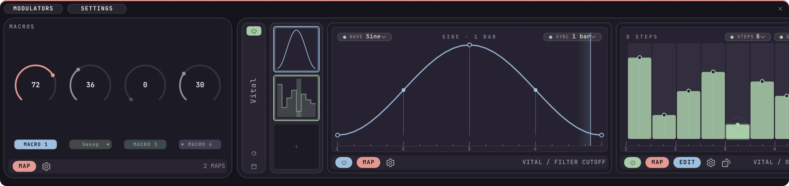
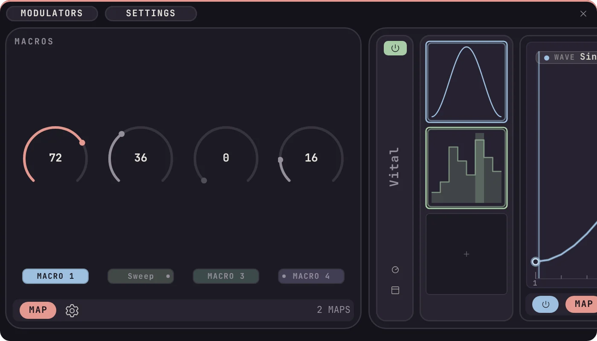
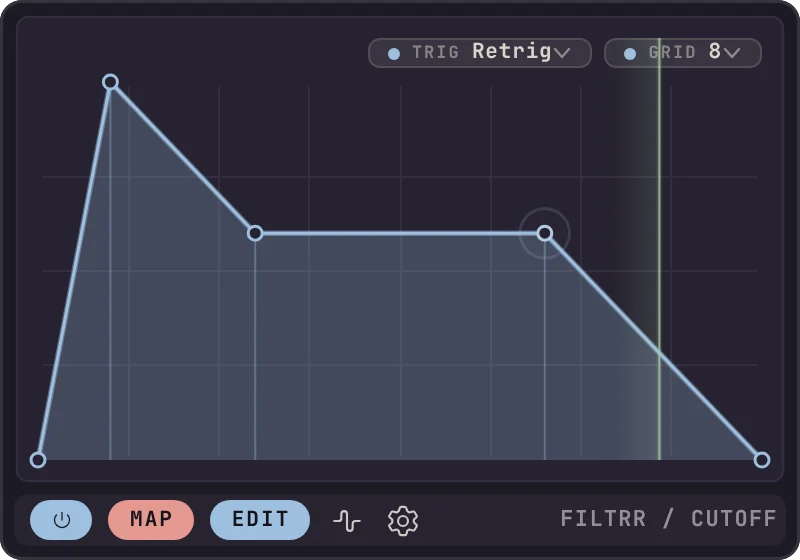
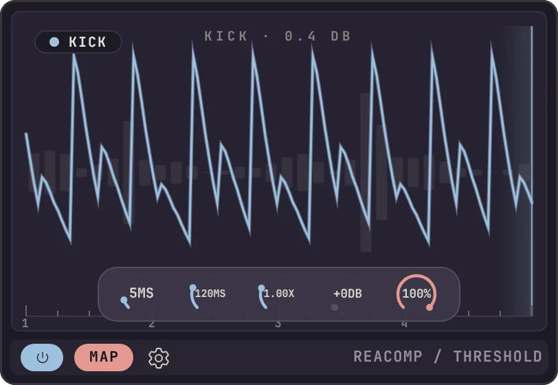
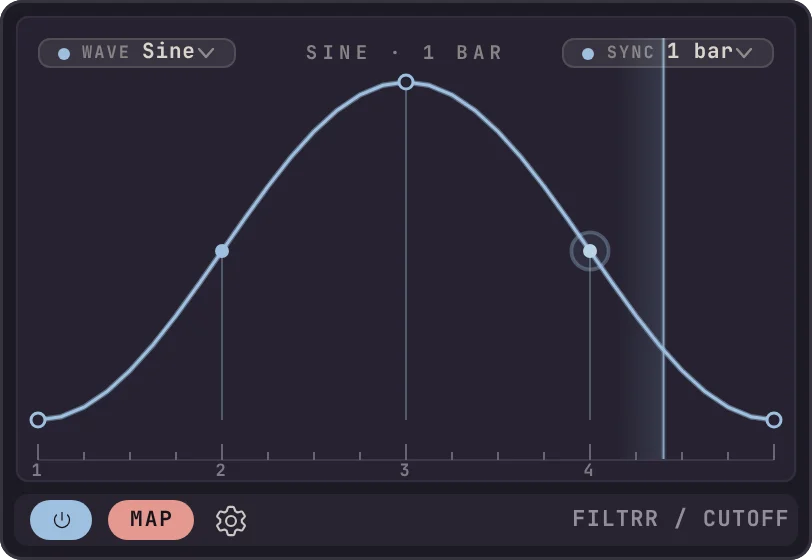
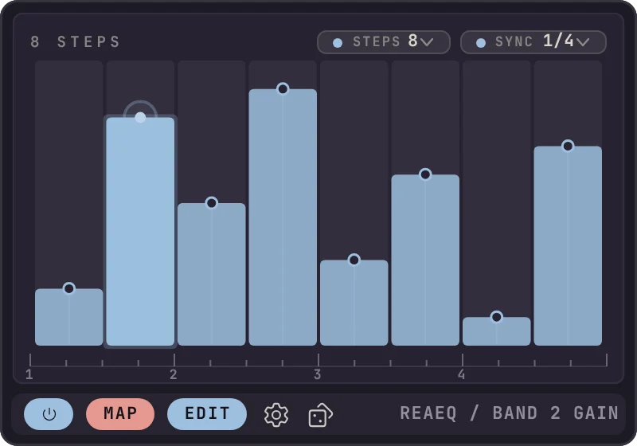
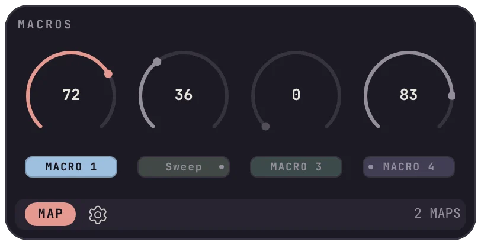
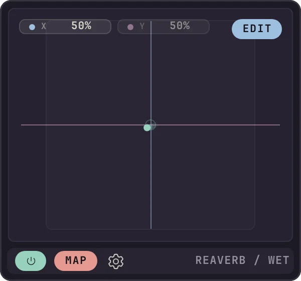

<p>
  <picture>
    <source media="(prefers-color-scheme: dark)" srcset="docs/images/kerf-audio-horizontal-on-dark.svg">
    
  </picture>
</p>

# Kerf Modulators

**A free, docked modulation panel for REAPER.** Seven modulators and a macro
panel on every track, driving any plugin parameter on any track.

REAPER can already modulate a plugin parameter, but only one at a time, through
a Parameter Modulation window a couple of clicks deep. Kerf Modulators puts it
all on one panel: pick a track, see every plugin on it, drop a modulator into a
slot and map it to as many parameters as you like. It stays locked to the beat
and saves with the project.

A thank-you to the REAPER community, which has inspired me since 2007.



> [!IMPORTANT]
> **Free public beta, version 0.5.0. Available now for Linux; macOS and Windows
> are coming soon.** It has been tested so far on small projects of around 10
> tracks and 20 plugins, and hasn't yet been tested thoroughly in edge cases or
> larger projects, so **expect bugs and back up your projects** before using it.

| | |
| --- | --- |
| **Version** | 0.5.0 beta |
| **Available now** | Linux (x86_64, glibc 2.35+) |
| **Coming soon** | macOS 11+ (Apple Silicon and Intel), Windows 10 and 11 (x64) |
| **Requires** | REAPER 6 or later, 64-bit, and [ReaPack](https://reapack.com) |
| **Price** | Free, including for commercial work |
| **Documentation** | [Install guide (PDF)](docs/kerf-modulators-install-guide.pdf) · [User manual (PDF)](docs/kerf-modulators-manual.pdf) |

## Install

Install with ReaPack. It installs the right build for your system and keeps it up to date.

1. Install [ReaPack](https://reapack.com) if you don't have it, and restart REAPER.
2. Choose **Extensions › ReaPack › Import repositories…**, paste this address and click OK:
   ```
   https://raw.githubusercontent.com/Kerf-Audio/reapack/main/index.xml
   ```
3. Choose **Extensions › ReaPack › Browse packages**, search for **Kerf Modulators**,
   right-click it, choose **Install**, then click **Apply**.
4. Restart REAPER.
5. Open the panel from **Extensions › Kerf Modulators: Show/hide panel**.

You can also install the Linux build by hand from [Releases](../../releases). See [INSTALL.md](INSTALL.md) for that, and for
upgrading and uninstalling.

## The panel

The panel follows the selected track. The track's macros sit on the left, then
one block per plugin, each with up to 12 modulator slots. Any slot can drive up
to 128 parameters, on its own track or any other.



## Modulators

### MSEG
A multi-stage envelope you draw yourself. Looped or one-shot, free or locked to
the grid, with per-segment curve shapes, delay, depth, a loop section and jitter.



### Envelope Follower
Turns the level of any track into modulation. Point it at a kick to duck a pad,
or at a vocal to open a filter. Invert the range for sidechain ducking on any
parameter.



### LFO
Six shapes (sine, triangle, saw, square, random and Perlin), free running or
tempo-synced, with phase and jitter. Runs on REAPER's own engine where it can,
so it's sample accurate.



### Steps
A step sequencer for parameters: up to 16 held values on a beat division you
choose, with one-click randomise.



### Macros
Four nameable knobs on every track, there from the moment the track exists, and
the hub every other modulator can drive. Map a modulator to a macro and
everything the macro drives follows.



### ADSR
A four-stage envelope triggered by the transport, by a cycle of N beats, or by
the start of each media item on the track.

### XY Pad
Two outputs in one control. Set a position and let it wander, freely or in
beat-locked jumps that play back the same every time.



### Waves
A curve library that always retriggers, with real curve operations (invert,
reverse, normalise, smooth, quantise, double, halve), sixteen levels of undo,
and your own saved shapes.

## Features

- Native REAPER docker: dock it, float it, and REAPER remembers where
- Follows the selected track, with one block per plugin and up to 12 slots each
- Up to 128 targets per modulator, each with its own range and polarity
- Cross-track modulation, including other tracks' macros, surviving reorders and renames
- Chaining through macros, with no feedback loops possible
- Quick knobs: two to eight hand knobs per plugin, with templates every new instance picks up
- Native REAPER modulation for the LFO and follower where possible, sample accurate
- Timing compensation, so beat-locked modulation lands on the grid
- Keeps running when the panel is hidden or another track is selected
- Everything saved in the project
- Four accent themes, in light or dark
- Built-in diagnostics for tracking down stutters

The [user manual](docs/kerf-modulators-manual.pdf) covers every control.

## How it's made

I have a real software development background and have been involved in the
music industry for over 30 years. This isn't vibe-coded. I used AI assistance,
but as part of a hybrid workflow with a person in charge at every step: a proper
development process, human oversight of every change, code reviews, and testing
in REAPER. It's still a beta and there will be issues. That is exactly why I
want the REAPER community testing it.

## Support and bugs

- **Bugs:** [open an issue](../../issues/new/choose). The form asks for your
  system, REAPER version and project size. A small `.RPP` that shows the problem
  helps most.
- **Questions:** ask in [Discussions](../../discussions).
- Support is through GitHub only. I read every report and fix what I can, as
  time allows, but there's no guaranteed timescale.

## Roadmap: testing first

This first release phase is for testing and bug fixing. **No new features will
be added until version 1.0 is out and stable.** Feature requests are welcome in
[Discussions](../../discussions) or as an issue, and they'll be looked at after
1.0.

## Licence

Kerf Modulators is free to use, including for commercial work, under the
[Kerf Audio Freeware Licence](LICENSE.txt). It is not open source, and it may not
be sold or redistributed; please link here instead. Third-party components are
listed in [THIRD-PARTY-NOTICES.txt](THIRD-PARTY-NOTICES.txt).

REAPER is a trademark of Cockos Incorporated. Kerf Audio is not affiliated with
or endorsed by Cockos.

Danny Wincott, trading as Kerf Audio
